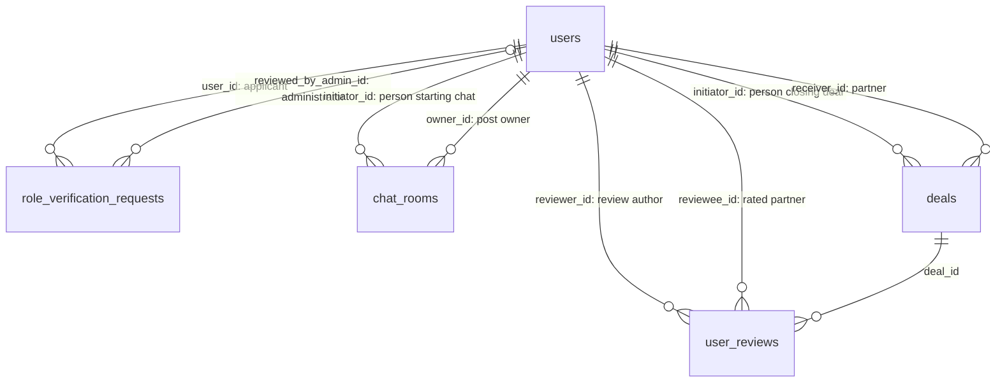

# Database integrity and maintenance

## Source of truth

The running app uses MySQL and `prisma/schema.prisma`. `database/schema.sql` is an older PostgreSQL design reference, not the app installation script. Initialize a new MySQL schema using Prisma, then run `npm run db:repair` to install the CHECK constraint that Prisma does not represent. Do not reset the existing app database.

`role_verification_requests.license_number` is document text, not a foreign key. Its only user references are `user_id` (applicant) and `reviewed_by_admin_id` (reviewing administrator). No self-reference from the license number to the request ID exists in the current schema or the inspected MySQL database.

## Deal and review rules

Closing a deal requires an authenticated room member, the actual partner, matching post and owner, an ACTIVE room, and an OPEN post. The API atomically claims the post and writes the agreement, chat messages and room states in one Serializable transaction. Concurrent requests retry serialization conflicts up to three attempts; a closed/hidden post cannot produce another accepted deal through this API.

Prices and quantities must be positive, finite numbers with at most two decimal places within their database column limits. `agreed_price_per_kg` stays null when it is unknown; a lump sum is not automatically interpreted as a per-kg price. The frontend rounds an explicitly derived per-kg price to two decimals.

The review API verifies room membership, partner, matching post, DEAL_CLOSED room and ACCEPTED deal. It disallows self reviews, enforces integer ratings 1–5 and one review per person/deal, and updates cached rating totals in the same Serializable transaction. `database/hardening.sql` also enforces rating 1–5 for direct database writes. Participant checks remain in the API; MySQL rejects a cross-column self-review CHECK with the existing cascading FK update actions.

`ACCEPTED` means agreement confirmed. It does not mean paid. The existing product records negotiation and agreements; a payment workflow, evidence upload and payment verification are outside this change. No payment state is inferred for historical deals.

## Counters and reconciliation

- `report_count`: total stored reports for a post, including all moderation statuses. Inserting a report and incrementing the counter are atomic. The parent row is locked before the child insert to avoid FK lock-upgrade deadlocks under concurrent reports. Owners cannot report their own posts.
- `view_count`: number of explicit detail opens, incremented atomically by `POST /api/posts/:id/view`. It does not count distinct visitors and is not a fraud-resistant analytics metric. List fetching and chat polling do not increment it. Hidden posts are excluded. Existing historical views cannot be reconstructed.
- `rating_avg` and `rating_count`: derived from stored reviews, not seed display values. With no reviews the existing display default remains 5.00 and count 0.

Run `npm run db:audit` for a read-only check. `npm run db:repair` first refuses invalid/self-review historical data, saves previous cached report/rating totals under `database/backups/`, installs the named rating CHECK if absent, and reconciles cached totals in a transaction. Source users, posts, reports and reviews are retained. MySQL DDL commits separately from the reconciliation transaction. Re-run after a schema reset; `prisma db push` does not install this CHECK.

## Daily market snapshots

Run `npm run stats:refresh` to rebuild today's Bangkok-date snapshot (Node 22.18+; tested on Node 26). This command can be called by a scheduler; this change does not install an OS scheduled task. The existing dashboard still computes its cards from the posts API and does not read this snapshot table.

The snapshot uses OPEN, non-outlier posts created in the last 7 days up to the execution time, grouped by variety, grade and location. It is a snapshot of asking prices, not paid transaction prices. Unknown variety/grade, invalid prices and lump sums without quantities are excluded. Per-ton prices are divided by 1,000; lump sums are divided by known kg quantity. Each valid post has equal weight in averages. CUT_SERVICE wages have a separate average and do not affect the fruit min/max. Volumes sum the stated quantities for BUY and SELL posts.

Re-running updates the same date/groups and clears obsolete computed values while retaining manually supplied `official_ref_price` and prior dates. Rows with no remaining samples retain null averages and zero counts. Historical states cannot be reconstructed from current post statuses.

## Tests

- `npm test`: route regression tests with controlled dependencies and price aggregation tests.
- `npm run test:db`: actual MySQL integration tests with mocked authentication only. Creates a randomly named `durian_hub_test_<hex>` database on the configured server, pushes the current Prisma schema, applies the CHECK, and removes only that disposable database afterwards. Requires CREATE/DROP DATABASE permission. Does not seed or reset the app database.
- `node node_modules/typescript/bin/tsc --noEmit --incremental false`
- `npm run build`

The integration suite covers permissions, concurrent deal closes, concurrent reviews and duplicate reviews, real transaction rollback, direct writes rejected by the rating CHECK, concurrent report/view increments, and repeatable market snapshots. It does not automate browser interaction, email delivery, or payment processing.
