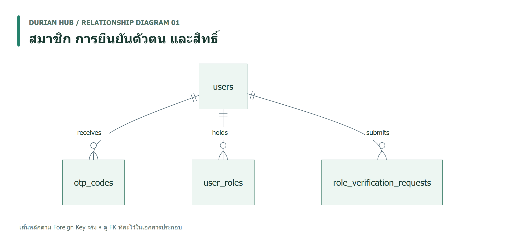
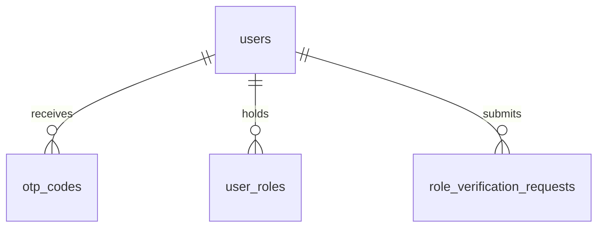
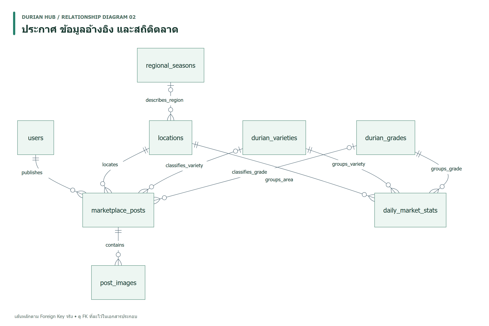
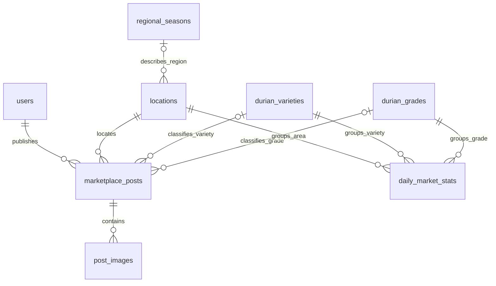
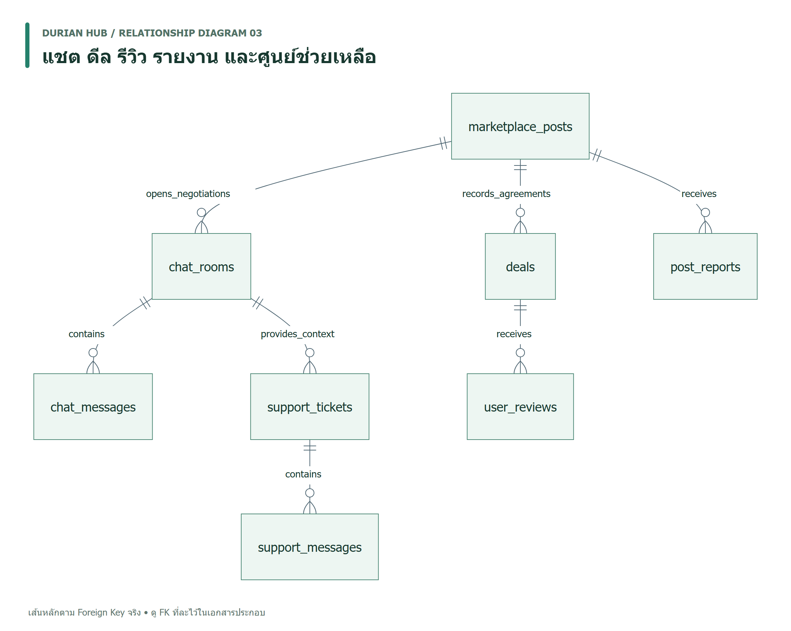
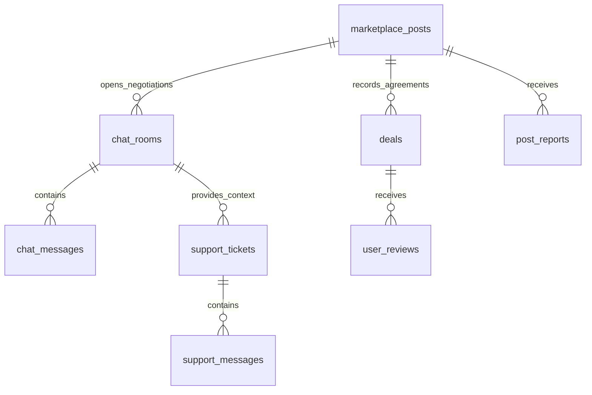
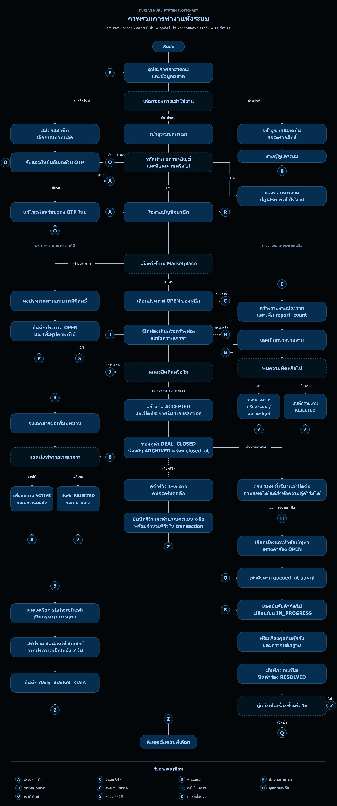
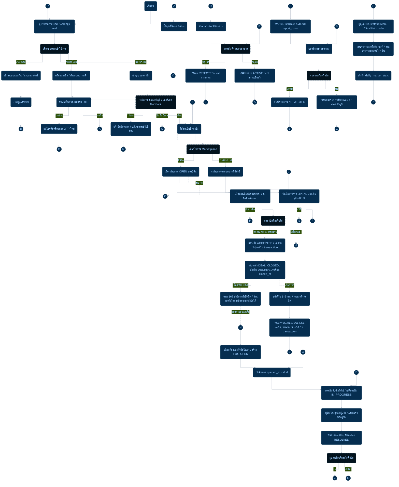

# ความสัมพันธ์ตาราง ภาพรวมระบบ และข้อเสนอแนะฐานข้อมูล — Durian Hub

ตรวจจาก source วันที่ 4 พฤศจิกายน 2026 โดยใช้ [Prisma schema](../prisma/schema.prisma) เป็นหลัก: MySQL จำนวน 18 ตาราง และ 31 Foreign Keys (FK) เอกสารนี้อธิบายโครงสร้างตาม source ไม่ใช่ผลตรวจฐานข้อมูลที่กำลังรัน

## 🧠 สิ่งที่ AI กำลังคิด & วิเคราะห์ (AI Rationale & Evidence)

- **ข้อเท็จจริง:** ตารางสมาชิกเชื่อมกับหลายบทบาทในธุรกรรมเดียวกัน เช่น ผู้เริ่มแชต/เจ้าของห้อง และผู้ให้/ผู้รับรีวิว หากวาดทุก FK พร้อมกันจะมีเส้นจำนวนมาก
- **ทางเลือกที่ใช้:** แบ่ง ER เป็น 3 กลุ่ม ใช้ชื่อ physical table ให้ตรงกับ MySQL แสดงเส้นหลัก และอธิบาย FK ที่ละไว้เป็นข้อความ ตาราง `users` และ `marketplace_posts` ที่ปรากฏซ้ำเป็นจุดเชื่อมของกลุ่ม ไม่ใช่ตารางใหม่
- **ขอบเขตและความเสี่ยง:** Flowchart แสดงพฤติกรรมที่พบใน API และ service ส่วนข้อเสนอแนะเป็นงานในอนาคต ยังไม่มีการแก้ schema หรือข้อมูลจริง ไม่ถือว่าทุกสถานะใน enum มีขั้นตอนใช้งานจริงแล้ว

## 1. ความสัมพันธ์ระหว่างตาราง (Relationship Diagram)

อ่านสัญลักษณ์: `||` = หนึ่งรายการที่จำเป็น, `o|` = ศูนย์หรือหนึ่งรายการ, `o{` = ศูนย์ถึงหลายรายการ เส้นใน ER ด้านล่างแสดง FK จริงที่เลือกมา ไม่ใช้เส้นแทนการคำนวณสถิติหรือกฎทางธุรกิจ

### กลุ่มที่ 1: สมาชิก การยืนยันตัวตน และสิทธิ์

[เปิด PNG ขนาดเต็ม](diagrams/relationship-01-members.png) · [เปิด SVG สำหรับขยาย](diagrams/relationship-01-members.svg)

ต้นฉบับ Mermaid

| ตาราง | หน้าที่และข้อกำหนดหลัก |
| --- | --- |
| `users` | บัญชีสมาชิก อีเมล/โทรศัพท์ไม่ซ้ำ เก็บบทบาทที่ใช้งาน คะแนนความประพฤติ สถานะบัญชี และยอดรวมรีวิว |
| `otp_codes` | hash ของ OTP แยกวัตถุประสงค์ยืนยันอีเมล/ตั้งรหัสผ่านใหม่ พร้อมวันหมดอายุ จำนวนครั้งที่ลอง และเวลาที่ใช้แล้ว |
| `user_roles` | บทบาทที่สมาชิกถืออยู่ กำหนด unique `(user_id, role_type)` |
| `role_verification_requests` | คำขอเพิ่มบทบาท เอกสารประกอบ ผลตรวจ และผู้ตรวจ |

**FK ที่ละไว้:** `users.location_id → locations.id` เป็น optional และ `role_verification_requests.reviewed_by_admin_id → users.id` เป็น optional เช่นกัน ผู้ตรวจเป็นบัญชีใน `users`; การเป็นแอดมินตรวจในแอป ไม่ได้มีตารางแอดมินแยก

คำขอไม่ได้มี FK ไป `user_roles` โดยตรง การอนุมัติเป็นการเปลี่ยนข้อมูลผ่าน API; `license_number` เป็นข้อความ ไม่ใช่ FK

หลักฐาน: [schema สมาชิกและบทบาท](../prisma/schema.prisma) บรรทัด 111–205

### กลุ่มที่ 2: ประกาศ ข้อมูลอ้างอิง และสถิติตลาด

[เปิด PNG ขนาดเต็ม](diagrams/relationship-02-marketplace.png) · [เปิด SVG สำหรับขยาย](diagrams/relationship-02-marketplace.svg)

ต้นฉบับ Mermaid

| ตาราง | หน้าที่และข้อกำหนดหลัก |
| --- | --- |
| `regional_seasons` | ข้อมูลฤดูกาลรายภูมิภาค รหัสภูมิภาคไม่ซ้ำ |
| `locations` | จังหวัด/อำเภอ กำหนด unique `(province, district)` และเชื่อมฤดูกาลได้แบบ optional |
| `durian_varieties` | สายพันธุ์ทุเรียน ชื่อไทยไม่ซ้ำ |
| `durian_grades` | เกรดทุเรียน รหัสเกรดไม่ซ้ำ |
| `marketplace_posts` | ประกาศ `SELL`, `BUY`, `CUT_SERVICE` มีเจ้าของและพื้นที่เสมอ ส่วนสายพันธุ์/เกรดเว้นว่างได้ |
| `post_images` | รูปประกาศหลายรูป พร้อมลำดับแสดงผล |
| `daily_market_stats` | สรุปตามวัน/สายพันธุ์/เกรด/พื้นที่ โดย unique ทั้ง 4 คอลัมน์ร่วมกัน |

**ข้อควรอ่าน:** ไม่มี FK จาก `daily_market_stats` ไป `marketplace_posts` สถิติเกิดจาก service ประมวลผลประกาศ ไม่ใช่ความสัมพันธ์แบบแถวต่อแถว จึงไม่วาดเส้นเชื่อมสองตารางนี้

สถิติที่คำนวณปัจจุบันเป็น snapshot ของ **ราคาเสนอ** จากประกาศ `OPEN` ที่ไม่เป็น outlier ในช่วงย้อนหลัง 7 วัน แปลงหน่วยเป็นบาท/กก. และข้ามข้อมูลที่ไม่มีสายพันธุ์/เกรดหรือแปลงราคาไม่ได้ ไม่ใช่ราคาซื้อขายสำเร็จจาก `deals` และไม่ใช่ราคาเฉพาะประกาศที่สร้างวันนั้น

หลักฐาน: [schema ข้อมูลตลาด](../prisma/schema.prisma) บรรทัด 212–317 และ 406–429; [service สถิติตลาด](../src/lib/market-stats.ts) บรรทัด 11–67

### กลุ่มที่ 3: แชต ดีล รีวิว รายงาน และศูนย์ช่วยเหลือ

[เปิด PNG ขนาดเต็ม](diagrams/relationship-03-transactions.png) · [เปิด SVG สำหรับขยาย](diagrams/relationship-03-transactions.svg)

ต้นฉบับ Mermaid

| ตาราง | หน้าที่และข้อกำหนดหลัก |
| --- | --- |
| `chat_rooms` | ห้องของประกาศกับผู้เริ่มแชต กำหนด unique `(post_id, initiator_id)` มีผู้เข้าร่วมสองฝ่าย |
| `chat_messages` | ข้อความในห้องและผู้ส่ง รองรับข้อความ การ์ดสินค้า ข้อความด่วน และรูปภาพตาม enum |
| `deals` | ข้อตกลงของประกาศกับคู่ค้า เก็บราคาและปริมาณที่ตกลง |
| `user_reviews` | คะแนนและความคิดเห็นคู่ค้า unique `(deal_id, reviewer_id)` ป้องกันผู้ให้คนเดิมรีวิวดีลเดิมซ้ำ |
| `post_reports` | รายงานประกาศ เหตุผล รายละเอียด ผู้แจ้ง และสถานะผลตรวจ |
| `support_tickets` | คำร้องส่วนตัวของผู้แจ้งในห้อง unique `(room_id, requester_id)` พร้อมคิว ผู้รับเรื่อง และผลแก้ไข |
| `support_messages` | บทสนทนาของคำร้องระหว่างผู้แจ้งกับแอดมิน |

**FK ไป `users` ที่ละไว้เพื่อลดเส้นซ้ำ:**

| ตาราง | คอลัมน์ที่อ้างถึง `users.id` |
| --- | --- |
| `chat_rooms` | `initiator_id`, `owner_id` |
| `chat_messages` | `sender_id` |
| `deals` | `initiator_id`, `receiver_id` |
| `user_reviews` | `reviewer_id`, `reviewee_id` |
| `post_reports` | `reporter_id` |
| `support_tickets` | `requester_id` |
| `support_messages` | `sender_id` |

แต่ละคอลัมน์ข้างต้นต้องอ้างถึงสมาชิกหนึ่งคน สมาชิกหนึ่งคนมีรายการที่อ้างถึงตนได้ศูนย์ถึงหลายรายการ

**ข้อจำกัดที่สำคัญ:**

- `support_tickets.handled_by_id` เป็น nullable integer และยังไม่มี FK ไป `users` จึงไม่วาดเป็นความสัมพันธ์ที่ DB บังคับ
- `deals` ไม่มี `room_id` แม้ API รับ `roomId` เพื่อตรวจสิทธิ์และอัปเดตห้อง รีวิวค้นหาดีลด้วยประกาศ/คู่ค้า/สถานะ จึงไม่มีเส้น FK ระหว่างห้องกับดีล
- เส้นประกาศไปดีลเป็น 1:N ตาม schema ปัจจุบัน แม้ API ปิดดีลจะใช้ transaction เปลี่ยนประกาศจาก `OPEN` เป็น `CLOSED` เพื่อป้องกันการปิดซ้ำ
- คำร้องมีได้หนึ่งรายการต่อห้องต่อผู้แจ้ง จึงอาจมีคำร้องแยกของคู่ค้าทั้งสองคนได้ และเปิดคำร้องเดิมซ้ำหลังแก้ไขแล้วได้
- CHECK คะแนนรีวิว 1–5 อยู่ใน [hardening.sql](../database/hardening.sql) และ SQL export; การตรวจคู่ค้า/ห้ามรีวิวตนเองทำใน API การใช้ Prisma schema อย่างเดียวไม่ยืนยันว่าฐานข้อมูลจริงมี CHECK แล้ว

หลักฐาน: [schema แชตและศูนย์ช่วยเหลือ](../prisma/schema.prisma) บรรทัด 324–399; [schema รายงาน ดีล และรีวิว](../prisma/schema.prisma) บรรทัด 436–487

## 2. Flowchart การทำงานภาพรวมทั้งระบบ

เส้นทึบแสดงทางเดินการทำงาน ส่วนเส้นประแสดงเส้นทางเพิ่มเติมหรือการประมวลผลที่เรียกแยกได้ ผังย่อรวมขั้นตรวจสอบทั่วไปไว้ในแต่ละกิจกรรม; ทุกขั้นเขียนข้อมูลยังต้องผ่านการตรวจสิทธิ์และ input ของ API

ภาพจัดจากบนลงล่าง ใช้เส้นหักมุม กล่องมุมมน และพื้นหลังดำตามแบบที่เลือก กล่องขอบเส้นประเป็นจุดตัดสินใจ ส่วนวงกลมตัวอักษรเดียวกันใช้ต่อทางเดินข้ามส่วน เช่น A กลับเข้าบัญชีสมาชิก, B งานแอดมิน, H ศูนย์ช่วยเหลือ และ Z สิ้นสุดขั้นตอน จึงไม่ต้องลากเส้นยาวข้ามภาพ ดูคำอธิบายรหัสทั้งหมดท้ายภาพ

การยืนยันบทบาทเพิ่มเติมเป็นทางเลือกหลังใช้งานบัญชีได้แล้ว ไม่ใช่เงื่อนไขบังคับให้สมาชิกใหม่ทุกคนต้องรอแอดมินอนุมัติ ภาพคงพฤติกรรมนี้ตามระบบจริง

[เปิด PNG ขนาดเต็ม](diagrams/system-flowchart.png) · [เปิด SVG สำหรับขยาย](diagrams/system-flowchart.svg)

ต้นฉบับ Mermaid ของขั้นตอนและเส้นทาง (ตำแหน่งภาพกำหนดด้วย SVG)

### เงื่อนไขที่ไม่ควรตีความเกินจากผัง

- ยืนยัน OTP สมัครสมาชิกสำเร็จจะสร้าง session ได้เลย ส่วนลืมรหัสผ่านใช้ OTP วัตถุประสงค์ `RESET_PASSWORD` ผ่าน [forgot-password API](../src/app/api/auth/forgot-password/route.ts) และ [reset-password API](../src/app/api/auth/reset-password/route.ts) เป็นเส้นทางกู้บัญชีแยก
- ประกาศสาธารณะเลือก `OPEN` และปกติจำกัดรายการใหม่ย้อนหลัง 7 วัน แต่ API มีตัวเลือกเปลี่ยนช่วงเวลา/รวมรายการเก่า กฎนี้ต่างจากการล็อกแชตหลังปิดดีล
- `ACCEPTED` หมายถึงข้อตกลงที่ API บันทึก ไม่ยืนยันการส่งมอบหรือชำระเงิน การมี enum `COMPLETED`, `DISPUTED`, `CANCELLED` ไม่ใช่หลักฐานว่ามี flow เปลี่ยนสถานะครบแล้ว
- `HISTORY` เป็นผลคำนวณจาก `closed_at + 168 ชั่วโมง` ไม่ใช่ enum ที่เพิ่มในตารางห้อง และไม่จำเป็นต้องมี background job เปลี่ยนสถานะเพื่อห้ามส่งข้อความ
- หลังปิดดีล สมาชิกยังส่งแชตคู่ค้าได้ก่อนครบกำหนดตาม guard ปัจจุบัน การรีวิวเป็นทางเลือกที่ทำได้เมื่อเข้าเงื่อนไข ไม่จำเป็นต้องรีวิวก่อนเปิดประวัติหรือขอความช่วยเหลือ
- ระบบช่วยเหลือแยกจากแชตคู่ค้า ใช้ได้แม้ห้องเป็นประวัติแล้ว ผู้แจ้งเห็นคำร้องตนเอง แอดมินผู้รับเรื่องจึงตอบและปิดเรื่องได้ เมื่อเปิดซ้ำจะรีเซ็ตผู้รับเรื่อง/ผลแก้ไขและตั้งเวลาเข้าคิวใหม่
- การคำนวณสถิติเรียกผ่าน script แยก ไม่ได้ยืนยันว่ามี scheduler ติดตั้งแล้ว และผังไม่ได้อ้างว่าหน้าจอทุกส่วนอ่านจาก `daily_market_stats`

### หลักฐานของ Flowchart

| กระบวนการ | แหล่งอ้างอิงและตำแหน่ง |
| --- | --- |
| สมัคร/ยืนยัน/เข้าใช้ | [register](../src/app/api/auth/register/route.ts), [verify-email](../src/app/api/auth/verify-email/route.ts), [login](../src/app/api/auth/login/route.ts): transaction สร้างบัญชี/บทบาท, OTP, สถานะบัญชีและ session |
| ประกาศและบทบาท | [posts](../src/app/api/posts/route.ts) บรรทัด 7–35 และ 128–144; [คำขอเพิ่มบทบาท](../src/app/api/user/role-requests/route.ts); [ผลพิจารณา](../src/app/api/admin/role-requests/[id]/route.ts) บรรทัด 56–119 |
| เปิดห้อง/ปิดดีล | [chat rooms](../src/app/api/chat/rooms/route.ts) บรรทัด 143–205; [deals](../src/app/api/deals/route.ts) บรรทัด 42–79 |
| รีวิว/ประวัติ | [reviews](../src/app/api/reviews/route.ts) บรรทัด 40–83; [chat-history](../src/lib/chat-history.ts) บรรทัด 1–7; [message guard](../src/app/api/chat/rooms/[id]/messages/route.ts) บรรทัด 95–96 |
| รายงานและลงโทษ | [report](../src/app/api/posts/[id]/report/route.ts) บรรทัด 25–35; [admin report](../src/app/api/admin/reports/[id]/route.ts) บรรทัด 47–109 |
| คำร้อง/คิว/เปิดซ้ำ | [support service](../src/lib/support.ts) บรรทัด 54–68, 102–148 |
| สถิติ | [refresh script](../scripts/refresh-market-stats.cjs) บรรทัด 5–16 และ [market-stats service](../src/lib/market-stats.ts) บรรทัด 46–67 |

## 3. ข้อเสนอแนะสำหรับฐานข้อมูลนี้

### 3.1 จุดแข็งที่ควรรักษา

- ใช้ `Decimal` สำหรับเงิน/ปริมาณ และแยกข้อมูลอ้างอิงสายพันธุ์ เกรด พื้นที่ออกจากประกาศ
- มี composite unique ป้องกันบทบาท ห้อง คำร้อง รีวิว และสถิติซ้ำตามคีย์ธุรกิจ
- การปิดดีลและบันทึกรีวิวใช้ serializable transaction พร้อม retry เมื่อเกิด serialization conflict; การรับคิวใช้ guarded update ใน transaction
- การสร้างรายงานเพิ่มตัวนับพร้อมสร้างแถวรายงานใน transaction แล้ว ไม่ควรเปลี่ยนกลับเป็นการเขียนแยก

### 3.2 จุดที่พบและแนวทางปรับปรุง

ระดับด้านล่างเป็นลำดับความสำคัญจาก source ไม่ใช่ผลยืนยันว่ามีข้อมูลเสียหรือเกิดเหตุในฐานข้อมูลจริง

| ระดับ / ประเด็น | หลักฐาน | แนวทางและผลแลกเปลี่ยน |
| --- | --- | --- |
| **สูง — งานแอดมินเขียนหลายตารางไม่เป็นหน่วยเดียว** | [admin report](../src/app/api/admin/reports/[id]/route.ts) บรรทัด 49–106 เขียนรายงาน/ประกาศ/บทลงโทษแยกกัน; [อนุมัติบทบาท](../src/app/api/admin/role-requests/[id]/route.ts) บรรทัด 58–118 เขียนคำขอ/บทบาท/บัญชีแยกกัน และไม่มี guard ว่าคำขอยัง PENDING | ใช้ transaction พร้อม guard สถานะเดิม ป้องกันกดซ้ำและคำขอพร้อมกัน ตรวจให้ service ลงโทษใช้ transaction client เดียวกันได้ หากขั้นกลางล้มเหลวจะ rollback ได้ แต่ต้องจัดการ conflict/retry และไม่ทำ I/O ที่ไม่เกี่ยวกับ DB ใน transaction |
| **สูง — ยังไม่มีประวัติการลงโทษที่เป็นโครงสร้าง** | [User](../prisma/schema.prisma) บรรทัด 125–131 เก็บคะแนน/เหตุผลล่าสุด; [PostReport](../prisma/schema.prisma) บรรทัด 436–448 ไม่มีผู้ตรวจ/เวลาตรวจ/คะแนนก่อนหลัง | เสนอตารางเหตุการณ์ลงโทษพร้อมผู้กระทำ เหตุผล คะแนนก่อนหลัง และ report อ้างอิง; เพิ่มข้อมูลการพิจารณารายงาน ใช้ event key ป้องกันลงโทษซ้ำ ข้อดีคือตรวจสอบย้อนหลังได้ แต่เพิ่มข้อมูลและต้องกำหนดสิทธิ์/อายุเก็บรักษา ห้ามสร้างประวัติย้อนหลังโดยเดา |
| **กลาง — ผู้รับคำร้องไม่มี FK** | [SupportTicket](../prisma/schema.prisma) บรรทัด 359–366 มี `handledById` แต่ไม่มี relation | ตรวจ orphan ก่อนเพิ่ม FK ไป `users.id`; เลือก Restrict หรือ SetNull ให้ตรงนโยบายบัญชี FK ป้องกันรหัสที่ไม่มีสมาชิกได้ แต่ไม่ได้บังคับว่าสมาชิกเป็นแอดมิน จึงยังต้องตรวจสิทธิ์ในแอป |
| **กลาง — ดีลไม่ผูกห้องโดยตรงและไม่เก็บหน่วยราคาเอง** | [Deal](../prisma/schema.prisma) บรรทัด 451–470 ไม่มี `roomId`/`priceUnit`; [reviews](../src/app/api/reviews/route.ts) บรรทัด 51–58 ค้นดีลล่าสุดด้วยประกาศและคู่ค้า | พิจารณาเพิ่ม room FK และ snapshot หน่วยราคาในดีล เพื่ออธิบายข้อตกลงโดยไม่ต้องพึ่งประกาศภายหลัง ต้องกำหนด 1:1 หรือ 1:N ให้ชัดก่อนเพิ่ม unique และ backfill เฉพาะรายการที่จับคู่ได้แน่นอน แยกรายการกำกวมให้ตรวจด้วยคน |
| **กลาง — ข้อกำหนดตัวเลขหลายรายการพึ่งแอป** | [schema](../prisma/schema.prisma) บรรทัด 125–127, 282–291, 456–458 และ [hardening.sql](../database/hardening.sql) มี CHECK เฉพาะคะแนนรีวิว | กำหนดขอบเขตธุรกิจแล้วพิจารณา CHECK เช่นคะแนนความประพฤติ 0–100 ตัวนับไม่ติดลบ ราคา/ปริมาณเป็นบวกเมื่อมีค่า และผู้ให้รีวิวต่างจากผู้รับ ตรวจข้อมูลเดิมและวิธี deploy CHECK ก่อนใช้; กฎคู่ค้าข้ามตารางยังต้องตรวจในแอป |
| **กลาง — การอ่านบางรายการยังไม่แบ่งหน้า** | [posts](../src/app/api/posts/route.ts) บรรทัด 30 เป็นต้นไป และ [รายการห้อง](../src/app/api/chat/rooms/route.ts) บรรทัด 13 เป็นต้นไปใช้ `findMany` ไม่มี `take`; [support evidence](../src/lib/support.ts) บรรทัด 89 โหลดข้อความหลักฐานทั้งห้อง | เพิ่ม cursor pagination โดยใช้ลำดับที่เสถียร เช่น `(createdAt, id)` และแบ่งหน้าหลักฐานด้วย ประเมิน candidate index จาก filter/order จริง เช่นประกาศ `(status, created_at, id)` วัด query plan/latency ก่อนเพิ่ม เพราะ index เพิ่มพื้นที่และภาระเขียน ยังสรุปไม่ได้ว่า query ช้าโดยไม่มีข้อมูลวัด |
| **กลาง — ค่ารวมอาจคลาดเคลื่อนเมื่อมีการเขียนนอกเส้นทางหลัก** | `rating_avg`, `rating_count`, `report_count` อยู่ใน [schema](../prisma/schema.prisma); [repair script](../scripts/repair-database.cjs) บรรทัด 7–13 โหมด audit ตรวจรีวิวผิดช่วง/รีวิวตนเอง ส่วนคำนวณ totals ใหม่อยู่โหมด apply บรรทัด 31–34 | ให้รีวิว/รายงานเป็นข้อมูลต้นทาง เพิ่ม audit เปรียบเทียบค่ารวมแบบ read-only ก่อน repair และแจ้งความต่าง ปัจจุบัน `db:audit` ยังไม่ได้ตรวจยอดรวมทั้งหมด อย่าใช้ข้อความ audit ผ่านเป็นข้อยืนยันว่า totals ตรง |
| **กลาง — นโยบายลบข้อมูลต้องพิจารณาร่วมกัน** | [schema](../prisma/schema.prisma) มี Cascade ในประกาศ/ห้อง/ข้อความ แต่ Restrict ในคำร้อง/ข้อความช่วยเหลือ และมี FK ดีล/รีวิวด้วย | ทำตารางผลกระทบการลบและทดสอบกับข้อมูลตัวอย่างก่อนใช้จริง พิจารณาปิดใช้งานหรือ anonymize บัญชีเพื่อคงหลักฐานธุรกรรม; การลบสมาชิกอาจถูก FK อื่นขวาง ไม่ควรถือว่า Cascade จะลบได้ทุกกรณี ข้อแลกเปลี่ยนคือยังต้องจัดการข้อมูลที่เก็บต่อ |
| **ต่ำ — ข้อมูลภูมิภาคมีหลายรูปแบบ** | [Location](../prisma/schema.prisma) บรรทัด 225–231 มีทั้ง `region` ข้อความและ `regionalSeasonId`; [RegionalSeason](../prisma/schema.prisma) บรรทัด 216–219 มีรายการพันธุ์/ช่วงฤดูเป็นข้อความ | กำหนดแหล่งอ้างอิงภูมิภาคเดียวและตรวจความสอดคล้อง หากต้องค้นหาตามเดือน/สายพันธุ์ค่อยแยกตารางฤดูกาลเพิ่ม ถ้าใช้แสดงข้อความอย่างเดียว โครงสร้างปัจจุบันอาจเพียงพอ การ normalize เพิ่มทันทีจะเพิ่มความซับซ้อน |

**ประเด็นที่ต้องตกลงกติกาก่อนเพิ่ม constraint:** `post_reports` ยังไม่มี unique `(post_id, reporter_id)` และ API รับรายงานซ้ำได้ ต้องตัดสินใจก่อนว่าคนเดิมรายงานเหตุใหม่ได้หรือไม่; ไม่ควรเพิ่ม unique แล้วทำให้หลักฐานรายงานซ้ำเดิมสูญหาย ส่วน `user_roles.is_primary_role` เป็น boolean แต่ unique ปัจจุบันบังคับเพียงบทบาทไม่ซ้ำ ไม่ได้บังคับหนึ่ง primary role ต่อสมาชิก ควรมี audit/transaction รักษากฎนี้หากเป็นข้อกำหนดของระบบ

### 3.3 แผนปรับปรุงตามลำดับ

1. **ระยะที่ 1 — ความถูกต้อง:** รวมงานแอดมินเป็น transaction พร้อม state guard/การป้องกันคำสั่งซ้ำ เพิ่ม audit แบบอ่านอย่างเดียวสำหรับ orphan, totals, primary role และค่าตัวเลขผิดช่วง ก่อนออกแบบ migration
2. **ระยะที่ 2 — ตรวจสอบย้อนหลัง:** ตกลงนโยบายการลงโทษ/การลบ/ดีลต่อห้อง แล้วเพิ่ม audit events, FK ผู้รับเรื่อง และข้อมูลข้อตกลง พร้อม backfill ที่ตรวจสอบได้และแผน rollback
3. **ระยะที่ 3 — รองรับข้อมูลเพิ่ม:** แบ่งหน้า วัด query plan และเวลาอ่าน/เขียนก่อนปรับ index; กำหนดวิธีรันและติดตามผล `stats:refresh` รวมถึงทดสอบ backup/restore ตาม [คู่มือ CMD](cmd-guide.md)

การปรับฐานข้อมูลแต่ละระยะควรมีแผน migration และการทดสอบกับฐานข้อมูลแยกก่อน เอกสารนี้เป็นข้อเสนอ ไม่ได้อนุมัติหรือดำเนินการเปลี่ยนฐานข้อมูลจริง

## ขอบเขตการตรวจเอกสาร

ตรวจจำนวนตารางและ FK จาก source, ชื่อตาราง/ปลายทางเส้น ER, unique/nullability และทางเดินหลักใน API/service ผลตรวจ: 18 ตาราง / 31 FK, เส้น ER ที่เลือก 19 เส้นตรงกับ FK และ optional cardinality ครอบคลุมครบ 18 ตาราง เก็บ Mermaid 4 blocks และตรวจลิงก์ภายในเอกสารนี้กับ docs/diagrams/README.md รวม 72 จุดผ่าน

ภาพ ER เรนเดอร์ด้วย Mermaid 11.12.2 ส่วน Flowchart กำหนดตำแหน่งใน SVG และส่งออก PNG ด้วย Chrome headless พร้อมตรวจ syntax ของ MMD ด้วย Mermaid แล้ว Flowchart มี 73 กล่อง/จุดเชื่อมและ 68 ลูกศร ตรวจตำแหน่งแล้วไม่พบกล่องทับกัน เส้นผ่านกล่องอื่น หรือเส้นตัดกันระหว่างทาง และไม่มีข้อความล้นกล่อง ภาพ PNG เปิดดูได้โดยไม่ต้องมี Mermaid viewer

ไม่ได้เชื่อมฐานข้อมูลจริงหรือยืนยัน deployment ปัจจุบัน รายละเอียดค่าที่ส่งออกอยู่ใน [render-checks.json](diagrams/render-checks.json)

ดู FK และคอลัมน์ครบทุกตัวได้ใน [ชุด schema SQL/DBML](../database/README.md)
