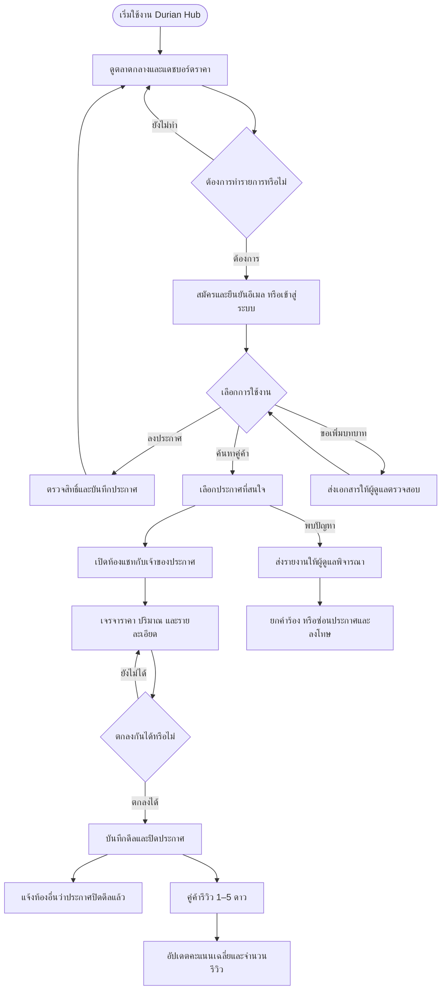
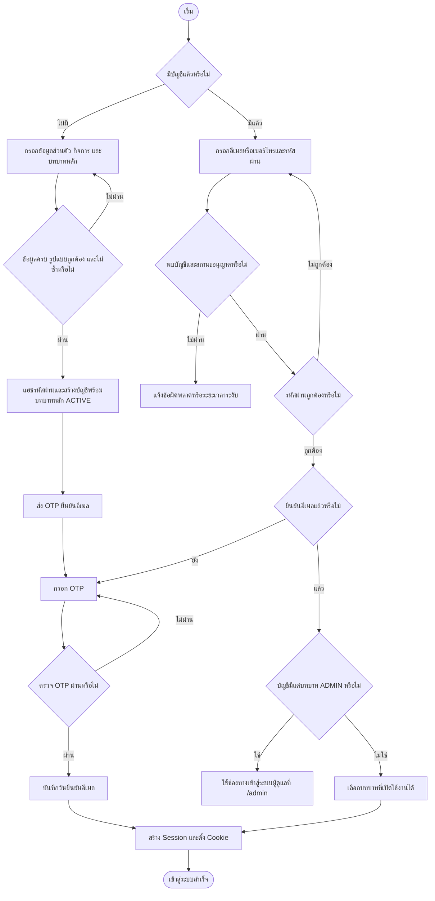
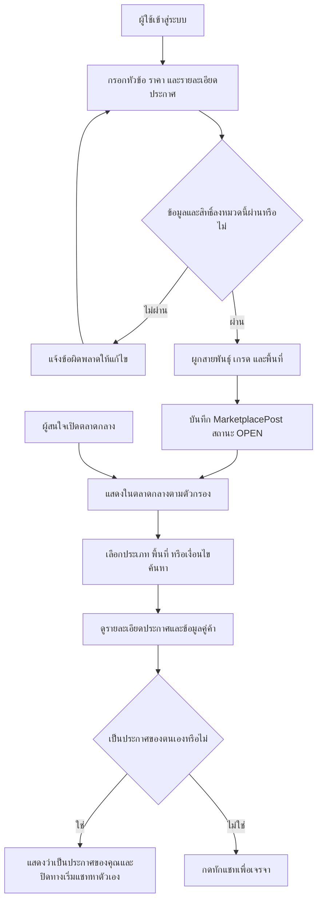
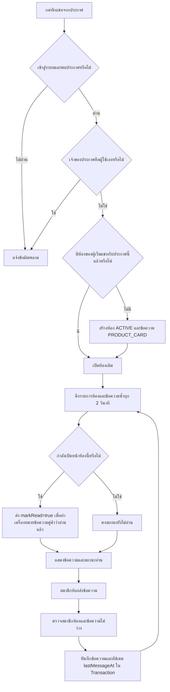
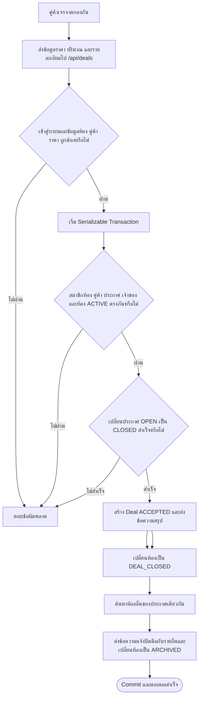
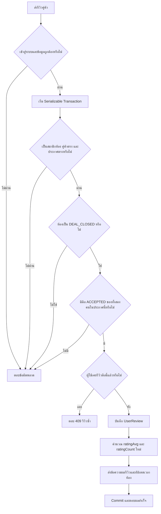
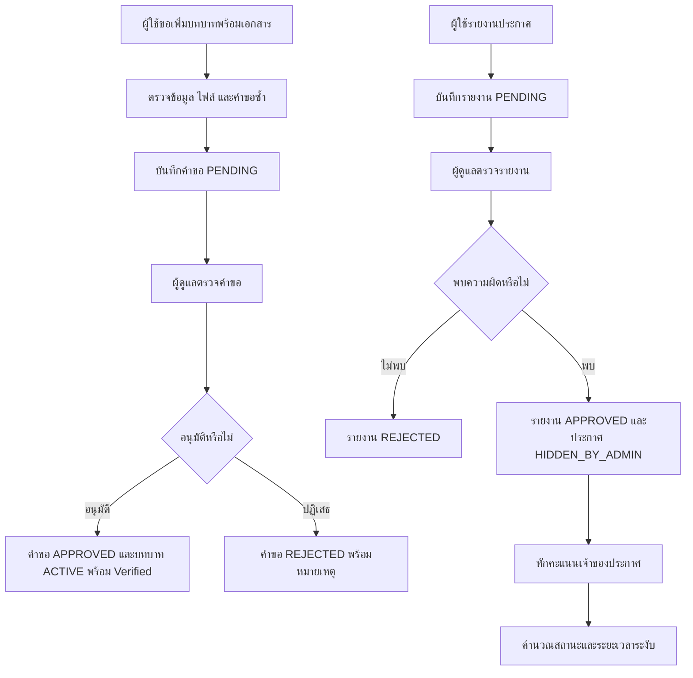
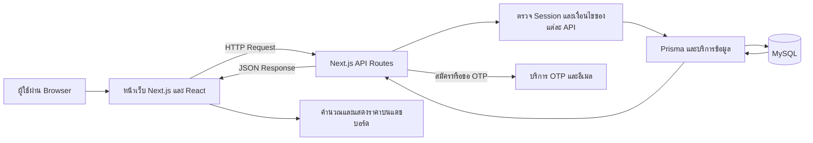

# Flowchart หลักการทำงานของ Durian Hub

วันที่ตรวจสอบโค้ด: 30 ตุลาคม 2569 (2026-10-30)

Durian Hub เป็นตลาดกลางเชื่อมผู้ขายทุเรียน ผู้รับซื้อ และทีมตัดทุเรียน ผู้ใช้ลงประกาศตามสิทธิ์ ค้นหาคู่ค้า เจรจาผ่านแชท บันทึกข้อตกลง และรีวิวคู่ค้าหลังปิดดีล ผู้ดูแลระบบตรวจคำขอเพิ่มบทบาทและรายงานปัญหา

เปิดไฟล์ด้วย Markdown Preview ที่รองรับ Mermaid เพื่อดูแผนภาพ กล่องสี่เหลี่ยมคือขั้นตอน รูปสี่เหลี่ยมข้าวหลามตัดคือเงื่อนไข และข้อความบนลูกศรคือผลการตัดสินใจ

## 1. ภาพรวมสำหรับนำเสนอ

การปิดดีลในผังหมายถึงการบันทึกข้อตกลงในระบบ ไม่ใช่การยืนยันว่าชำระเงินหรือส่งมอบสินค้าแล้ว API ที่ตรวจสอบไม่ได้ทำขั้นตอนชำระเงินหรือจัดส่ง

## 2. สมัครสมาชิก ยืนยันอีเมล และเข้าสู่ระบบ

- บทบาทหลักตอนสมัครสร้างเป็น `ACTIVE` และ `isVerified: false` จึงไม่ใช่การรอแอดมินอนุมัติก่อนใช้งานทุกบัญชี
- บัญชี `BANNED` หรือยังอยู่ในช่วง `SUSPENDED` เข้าสู่ระบบไม่ได้ เมื่อพ้นกำหนดระงับ โค้ดเปลี่ยนสถานะกลับเป็น `ACTIVE` ขณะตรวจบัญชี
- การส่ง OTP ใหม่ใช้ `/api/auth/resend-otp` ส่วนลืมรหัสผ่านมี `/api/auth/forgot-password` และ `/api/auth/reset-password`

หลักฐาน: [register](../src/app/api/auth/register/route.ts), [verify-email](../src/app/api/auth/verify-email/route.ts), [login](../src/app/api/auth/login/route.ts), [auth](../src/lib/auth.ts)

## 3. ลงประกาศและค้นหาคู่ค้า

| บทบาท | ประเภทประกาศ |
|---|---|
| ผู้ขาย `SELLER` | ขายทุเรียน `SELL` |
| ผู้รับซื้อ `BUYER` | รับซื้อทุเรียน `BUY` |
| ทีมตัด `CUTTER` | บริการตัดทุเรียน `CUT_SERVICE` |

API อนุญาตตามบทบาทปัจจุบัน หรือบทบาทเพิ่มเติมที่มีสถานะ `ACTIVE` และมีข้อยกเว้นสำหรับผู้มีบทบาทแอดมิน โดยค่าเริ่มต้น GET ประกาศดึงเฉพาะ `OPEN` ที่สร้างใน 7 วันล่าสุด การพ้นช่วงนี้เป็นการกรองผลลัพธ์ ไม่ใช่การลบข้อมูลหรือเปลี่ยนสถานะอัตโนมัติ

หลักฐาน: [posts API](../src/app/api/posts/route.ts), [หน้าเว็บหลัก](../src/app/page.tsx)

## 4. แชทและสถานะอ่านข้อความ

ระบบใช้ HTTP polling ทุก 2 วินาทีเมื่อเข้าสู่ระบบ โดยดึงรายการห้อง และดึงข้อความเมื่อมีห้องที่เลือกอยู่ GET/POST ข้อความตรวจว่าผู้ใช้เป็นผู้เริ่มแชทหรือเจ้าของห้อง จำนวนยังไม่อ่านคำนวณจากข้อความคู่ค้าที่ `isRead: false`

หลักฐาน: [ห้องแชท](../src/app/api/chat/rooms/route.ts), [ข้อความ](../src/app/api/chat/rooms/[id]/messages/route.ts), [polling ในหน้าเว็บ](../src/app/page.tsx)

## 5. ปิดดีลและแจ้งคู่ค้ารายอื่น

| ข้อมูล | สถานะหลังปิดดีลตามเส้นทางปกติที่ส่ง roomId |
|---|---|
| ข้อตกลงซื้อขาย | `Deal.ACCEPTED` |
| ประกาศ | `MarketplacePost.CLOSED` |
| ห้องคู่ค้าที่ปิดดีล | `ChatRoom.DEAL_CLOSED` |
| ห้องอื่นของประกาศเดียวกัน | `ChatRoom.ARCHIVED` |

`/api/deals` ต้องส่ง `roomId` และตรวจสมาชิกห้อง คู่ค้า ประกาศ เจ้าของ และห้อง `ACTIVE` ก่อนปิดดีล รวมการเขียนทั้งหมดไว้ใน Serializable Transaction และเปลี่ยนสถานะประกาศแบบมีเงื่อนไข `OPEN` เพื่อให้มีผู้ปิดดีลสำเร็จเพียงรายเดียว หากเขียนขั้นตอนใดไม่สำเร็จจะ rollback ทั้งหมด และ retry serialization conflict สูงสุด 3 ครั้ง ห้องอื่นที่ยัง `ACTIVE` จะถูกเปลี่ยนเป็น `ARCHIVED` ทั้งนี้ `ACCEPTED` เป็นการยืนยันข้อตกลง ไม่ได้ยืนยันการชำระเงิน และ `ARCHIVED` ไม่ได้ทำให้ API ส่งข้อความปฏิเสธการสนทนาอัตโนมัติ

หลักฐาน: [deals API](../src/app/api/deals/route.ts), [messages API](../src/app/api/chat/rooms/[id]/messages/route.ts)

## 6. รีวิวคู่ค้าหลังปิดดีล

- ต้องส่ง `roomId`, `postId`, `revieweeId` และคะแนนเต็ม 1–5 ดาว ห้ามรีวิวตัวเอง ความคิดเห็นยาวไม่เกิน 5,000 ตัวอักษร
- จำกัดหนึ่งรีวิวต่อผู้รีวิวต่อดีลด้วย `@@unique([dealId, reviewerId])` ทั้งสองฝ่ายจึงรีวิวกันได้คนละครั้ง
- ทุกการเขียนในกระบวนการรีวิวอยู่ใน Transaction เดียว หากเกิด serialization conflict `P2034` จะลองใหม่ โดยรวมสูงสุด 3 ครั้ง ก่อนตอบ 409; หากผิดพลาดระหว่าง Transaction จะไม่บันทึกเพียงบางส่วน
- ห้องเก่าที่ไม่มีดีล `ACCEPTED` ต้องตรวจข้อมูลกับผู้ดูแล API รีวิวไม่สร้างดีลย้อนหลังให้เอง

หลักฐาน: [reviews API](../src/app/api/reviews/route.ts), [schema](../prisma/schema.prisma)

## 7. ผู้ดูแลระบบ: เพิ่มบทบาทและจัดการรายงาน

| คะแนนความประพฤติคงเหลือ | ผลจากการประเมินบทลงโทษ |
|---|---|
| 90–100 | `ACTIVE` ปกติ |
| 80–89 | `ACTIVE` ตักเตือน |
| 60–79 | `SUSPENDED` 3 วัน |
| 40–59 | `SUSPENDED` 7 วัน |
| 1–39 | `SUSPENDED` 30 วัน |
| 0 | `BANNED` ถาวร |

คะแนนความประพฤติ `trustScore` แยกจากคะแนนรีวิว `ratingAvg` การได้ดาวรีวิวไม่ใช่การเพิ่มคะแนนความประพฤติ เมื่อครบกำหนดระงับ การตรวจบัญชีสามารถคืนสถานะ `ACTIVE` โดยไม่ได้รีเซ็ตคะแนนกลับเป็น 100 อัตโนมัติ

หลักฐาน: [ขอเพิ่มบทบาท](../src/app/api/user/role-requests/route.ts), [อนุมัติบทบาท](../src/app/api/admin/role-requests/[id]/route.ts), [รายงานประกาศ](../src/app/api/posts/[id]/report/route.ts), [จัดการรายงาน](../src/app/api/admin/reports/[id]/route.ts), [เกณฑ์คะแนน](../src/lib/trust.ts), [ตรวจบัญชี](../src/lib/auth.ts)

## 8. โครงสร้างการทำงานและแดชบอร์ดราคา

หน้าเว็บหลักอยู่ใน `src/app/page.tsx` ส่วน API แยกตามงานใน `src/app/api` และโครงสร้างข้อมูลอยู่ใน `prisma/schema.prisma` แดชบอร์ดรายภูมิภาคคำนวณราคาเฉลี่ยจากประกาศที่โหลดมาเมื่อมีข้อมูล หากไม่มีจะใช้ค่าตั้งต้น ส่วนราคาแยกเกรดมีทั้งการคำนวณจากประกาศตรงเกรดและค่าประมาณจาก `buildGradesForVariety` จึงไม่ควรอธิบายว่าทุกตัวเลขเป็นราคาธุรกรรมจริงหรือราคาทางการ

## 9. ขอบเขตการตรวจสอบ

เอกสารนี้อธิบายตามการอ่านโค้ด ณ วันที่ระบุ ไม่ใช่ผลทดสอบระบบครบวงจร ในงานเอกสารนี้ไม่ได้เรียก API เพื่อสร้างบัญชี ปิดดีล หรือแก้ฐานข้อมูล และไม่ได้ทดสอบคำขอพร้อมกันกับ MySQL จริง สถานะทดสอบเดิมใน CURRENT_TASK.md ระบุว่ารีวิวผ่าน mock tests 21/21 โดยยังมีงานทดสอบ MySQL และ flow ครบวงจรต่อไป

## คำอธิบายสั้นสำหรับพูดนำเสนอ

“Durian Hub เป็นตลาดกลางทุเรียนที่เชื่อมชาวสวน ผู้รับซื้อ และทีมตัด ผู้ใช้สมัครและยืนยันอีเมล จากนั้นลงประกาศตามบทบาทหรือค้นหาคู่ค้า เมื่อพบประกาศที่สนใจสามารถแชทเจรจาและบันทึกการปิดดีล ระบบปิดประกาศและแจ้งผู้สนใจรายอื่น คู่ค้าที่ปิดดีลแล้วให้คะแนนรีวิวกันได้ ส่วนผู้ดูแลตรวจคำขอเพิ่มบทบาทและรายงานปัญหา พร้อมใช้คะแนนความประพฤติช่วยดูแลการใช้งาน”
