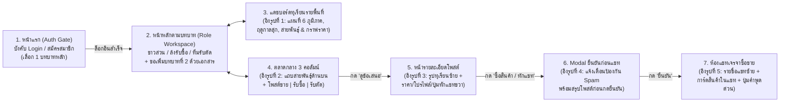
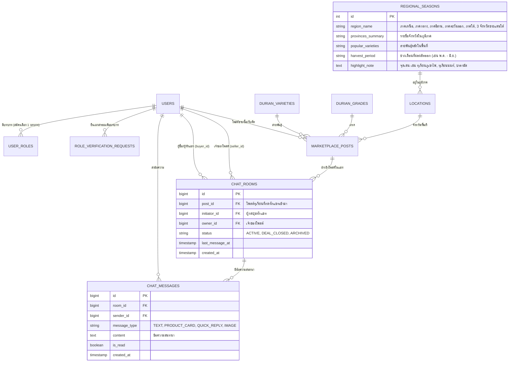

# แผนการพัฒนาและออกแบบฐานข้อมูลใหม่ (Revised Plan v2): ตลาดกลางทุเรียน (Durian Hub)

ปรับปรุงแผนการไหลของหน้าเว็บ (User Flow), โครงสร้าง UI/UX และฐานข้อมูลใหม่ทั้งหมด เพื่อให้ตรงตาม Concept และภาพอ้างอิงทั้ง 5 รูป พร้อมคุมโทนเว็บไซต์แบบ **Minimal Modern (เรียบ สบายตา โมเดิร์น โทนสีขาว-เทาอ่อน-เขียวใบไม้พาสเทล)** ครับ

---

## 1. ลำดับการทำงานของระบบ (User Journey & Screen Flow)

---

## 2. รายละเอียดการออกแบบทั้ง 6 หน้าจอ (อ้างอิงตามรูปที่ 1 - 5)

### หน้าจอที่ 1: หน้าแรกเข้าสู่ระบบ / สมัครสมาชิก (Auth Gate First)
- **กติกา:** เมื่อเข้าเว็บไซต์ครั้งแรก ระบบจะ **ยังไม่แสดงหน้าเนื้อหา** แต่จะแสดงหน้า **Login / Register** ที่ออกแบบเรียบหรู สบายตา
- **การสมัครสมาชิก:**
  - กรอกชื่อ-นามสกุล, เบอร์โทร/อีเมล, รหัสผ่าน, จังหวัดที่ตั้ง
  - **เลือกบทบาทหลักได้เพียง 1 บทบาท** (`ผู้ขาย/ชาวสวน`, `ผู้ซื้อ/ล้ง`, หรือ `ผู้รับตัดทุเรียน`)
- **ทางลัดสำหรับทดสอบ (Demo Quick Login):** มีปุ่มจำลองการล็อกอินเข้าสู่แต่ละบทบาท (ชาวสวน / ล้ง / ทีมตัด / Admin) ในคลิกเดียวเพื่อความสะดวกในการนำเสนอโปรเจกต์

### หน้าจอที่ 2: หน้าพื้นที่ทำงานตามบทบาท (Role-Specific Workspace)
เมื่อล็อกอินสำเร็จ ระบบจะพาเข้าสู่หน้าตามบทบาทที่สมัครไว้ทันที:
- **ถ้าล็อกอินเป็น `ผู้ขาย (ชาวสวน)`:** เห็นปุ่มลัด *"ลงประกาศขายทุเรียนหน้าสวน"*, รายการโพสต์ขายของตัวเอง, และราคารับซื้อหน้าล้งในจังหวัดตัวเอง
- **ถ้าล็อกอินเป็น `ผู้ซื้อ (ล้ง)`:** เห็นปุ่มลัด *"ประกาศราคารับซื้อประจำวัน"*, รายการสวนที่พร้อมตัด, และสถิติปริมาณทุเรียนในพื้นที่
- **ถ้าล็อกอินเป็น `ผู้รับตัด (ทีมตัด)`:** เห็นปุ่มลัด *"ลงประกาศคิวว่างรับตัดทุเรียน"*, ตารางนัดหมายงานตัด, และเรทค่าจ้างตัดเฉลี่ย
- **ปุ่มขอเพิ่มบทบาทที่ 2:** หากต้องการเปิดสิทธิ์บทบาทอื่นเพิ่ม จะมีเมนู *"ยื่นเอกสารขอเพิ่มบทบาท"* เพื่อให้ Admin ตรวจสอบก่อนสลับบทบาทได้

### หน้าจอที่ 3: แดชบอร์ดทุเรียนแต่ละพื้นที่และฤดูกาล (อ้างอิงรูปที่ 1)
ออกแบบหน้า Dashboard ให้แสดงข้อมูลครบทั้ง **ภูมิภาค + จังหวัด + สายพันธุ์เด่น + ช่วงเดือนที่ผลผลิตออก + กราฟราคากลาง**:
1. **ภาคเหนือ** (กำแพงเพชร, พิจิตร, อุตรดิตถ์, ตาก, สุโขทัย, พิษณุโลก, เพชรบูรณ์)
   - สายพันธุ์: หมอนทอง, ชะนี, ก้านยาว, กระดุม | **ผลผลิตช่วง: เม.ย. – พ.ค.**
2. **ภาคกลาง** (สระบุรี, นครนายก, กาญจนบุรี, อุทัยธานี, นนทบุรี)
   - สายพันธุ์: หมอนทอง, ชะนี, ก้านยาว, กระดุม, ทุเรียนนนท์ | **ผลผลิตช่วง: พ.ค. – มิ.ย.**
3. **ภาคอีสาน** (ชัยภูมิ - ทุเรียนโอโซน, ศรีสะเกษ - ทุเรียนภูเขาไฟ)
   - สายพันธุ์: หมอนทองภูเขาไฟ, โอโซน | **ผลผลิตช่วง: มิ.ย. – ก.ค.**
4. **ภาคตะวันออก** (ระยอง, จันทบุรี, ตราด)
   - สายพันธุ์: หมอนทอง, ชะนี, ก้านยาว, กระดุม | **ก่อนฤดูกาล: ก.พ. – เม.ย. / ตามฤดูกาล: พ.ค. – มิ.ย.**
5. **ภาคใต้** (ชุมพร, สุราษฎร์ธานี, นครศรีธรรมราช, ระนอง, พังงา, กระบี่, ภูเก็ต, ตรัง)
   - สายพันธุ์: พื้นบ้าน, หมอนทอง, ชะนี, ก้านยาว, กระดุม | **ผลผลิตช่วง: ก.ย. – ต.ค.**
6. **3 จังหวัดชายแดนใต้** (ยะลา, ปัตตานี, นราธิวาส)
   - สายพันธุ์: ทุเรียนบาตามัส, หมอนทอง | **ผลผลิตช่วง: ส.ค. – ต.ค.**
- **ส่วนประกอบเพิ่มเติมในหน้านี้:** เมื่อคลิกเลือกแต่ละภูมิภาค จะแสดง **กราฟเปรียบเทียบราคารับซื้อหน้าล้ง vs ราคาขายหน้าสวน** ของสายพันธุ์ในภูมิภาคนั้น พร้อมการ์ดความรู้ *"วิธีดูทุเรียนสุก"* (ก้านแข็งสีเข้ม, ผิวเป็นเม็ดทราย, ปลายหนามแห้งสีน้ำตาล, ร่องพูแยกเห็นชัด)

### หน้าจอที่ 4: ตลาดกลางซื้อ-ขาย-รับตัด (อ้างอิงรูปที่ 2)
ปรับโฉมจากธีมมืดในรูปตัวอย่างให้เป็น **ธีมสว่าง मोเดิร์น สบายตา (Clean Light Mode)** แต่คงโครงสร้าง Layout เดิมที่ใช้งานง่ายไว้ครบถ้วน:
- **แถบการ์ดสายพันธุ์ทุเรียนด้านบน (Item Strip):** แถบไอคอนรูปสายพันธุ์ทุเรียน (หมอนทอง, ชะนี, ก้านยาว, พวงมณี, กระดุม, ทุเรียนนนท์, ทุเรียนภูเขาไฟ, บาตามัส) ให้คลิกกรองได้ทันที
- **แถบค้นหาและตัวกรอง (Search & Filter Bar):** เลือกภูมิภาค/จังหวัด, เลือกเกรด (AB, C, D), ช่องค้นหาคำสำคัญ, ปุ่ม *"ดูโพสต์ของคุณ"*, และปุ่ม *"ราคาเด่นวันนี้"*
- **กระดาน 3 คอลัมน์ขนานกัน (3-Column Board):**
  - **คอลัมน์ที่ 1: โพสต์ขายทุเรียน (`Sell Orders`)** — ป้ายสีเขียว `"ต้องการขาย"` แสดงชื่อชาวสวน, ดาวรีวิว, เวลาโพสต์, สายพันธุ์/ปริมาณ $\rightarrow$ ราคา บาท/กก. และปุ่ม **`ดูข้อเสนอ`**
  - **คอลัมน์ที่ 2: โพสต์รับซื้อทุเรียน (`Buy Orders`)** — ป้ายสีฟ้า `"ต้องการซื้อ"` แสดงชื่อล้ง, ดาวรีวิว, สายพันธุ์ที่รับซื้อ $\rightarrow$ ราคาหน้าล้ง บาท/กก. และปุ่ม **`ดูข้อเสนอ`**
  - **คอลัมน์ที่ 3: โพสต์รับตัดทุเรียน (`Cut Service Orders`)** — ป้ายสีม่วง/อำพัน `"รับจ้างตัด"` แสดงชื่อทีมตัด, จำนวนคนในทีม $\rightarrow$ เรทค่าจ้าง บาท/กก. และปุ่ม **`ดูข้อเสนอ`**
- **ปุ่มลอยมุมขวาล่าง (`+` Floating Action Button):** กดเพื่อสร้างโพสต์ใหม่ตามบทบาทของตัวเอง

### หน้าจอที่ 5: หน้ารายละเอียดโพสต์ & Modal ยืนยันก่อนแชท (อ้างอิงรูปที่ 3 และ รูปที่ 4)
เมื่อกดปุ่ม **`ดูข้อเสนอ`** จากหน้าตลาดกลาง จะเข้าสู่มุมมองรายละเอียด:
- **ฝั่งซ้าย:** รูปภาพทุเรียน/สวนขนาดใหญ่ พร้อมกล่อง **`รายละเอียดผลผลิต (PRODUCT DETAIL)`** ด้านล่าง (เช่น เปอร์เซ็นต์แป้ง 34%, พื้นที่สวน อ.ท่าใหม่ จ.จันทบุรี, วันที่พร้อมตัด)
- **ฝั่งขวา (การ์ดข้อมูลขาวสะอาดตา):**
  - ป้ายกำกับด้านบน: `[ขาย/รับซื้อ/รับตัด]` `[เกรด AB ส่งออก]` `[ภาคตะวันออก]` และวันที่โพสต์
  - ชื่อหัวข้อสายพันธุ์ทุเรียน และกล่องราคาขนาดใหญ่ เช่น **`172 THB / ต่อกิโลกรัม`** (พร้อมปริมาณรวม)
  - การ์ดผู้โพสต์: รูปโปรไฟล์, ชื่อสวน/ล้ง, เครื่องหมายยืนยันตัวตนสีเขียว, ปุ่มช่องทางติดต่อ, คะแนนรีวิว `⭐ 5.0 (32)`, `🛡️ เครดิต 108`, และปุ่ม `ชมโปรไฟล์สวน/ล้ง`
  - ปุ่มหลักขนาดใหญ่: **`💬 ซื้อสินค้า / ทักแชท`**
  - ปุ่มรองด้านล่าง: **`แชร์ลง Facebook`** และ **`คัดลอกโพสต์ลงกลุ่ม`**
- **Modal แจ้งเตือนยืนยันก่อนเข้าแชท (อ้างอิงรูปที่ 4):**
  - เมื่อกดปุ่ม **`💬 ซื้อสินค้า / ทักแชท`** จะเด้งหน้าต่างกลางจอ:
  - หัวข้อ: **`🛡️ SECURE CHANNEL LINK — คุณต้องการส่งข้อความหรือไม่?`**
  - แสดงกรอบสรุปรายการทุเรียน ราคา และชื่อผู้โพสต์
  - กล่องคำเตือนสีเหลืองอำพัน: **`⚠️ คำเตือน: การกดก่อกวน ปั่นราคา หรือ Spam อาจทำให้บัญชีถูกระงับ`**
  - ปุ่ม **`ยกเลิก`** และปุ่ม **`ยืนยัน >`**

### หน้าจอที่ 6: ระบบห้องแชทซื้อขายทุเรียน (อ้างอิงรูปที่ 5)
เมื่อกด **`ยืนยัน >`** จาก Modal ระบบจะสร้างห้องสนทนาและพามาที่หน้า **ข้อความ (Chat Messenger)**:
- **คอลัมน์ซ้าย (รายการแชท):** แสดงรายชื่อคู่ค้าที่กำลังคุยอยู่ ชื่อโพสต์ทุเรียนที่อ้างอิง ข้อความล่าสุด และเวลา
- **พื้นที่หลักฝั่งขวา (หน้าต่างสนทนา):**
  - **ส่วนหัวแชท (Header):** รูปโปรไฟล์คู่ค้า, ชื่อ, สถานะใช้งานล่าสุด, ชื่อโพสต์ทุเรียนที่กำลังดีล และปุ่มมุมขวาบน **`🏪 ดูโปรไฟล์สวน/ล้ง`** กับ **`⭐ รีวิวคู่ค้า`**
  - **การ์ดอ้างอิงสินค้าในห้องแชท (Product Context Card):** แสดงการ์ดรูปทุเรียน ป้ายราคา `172 THB/กก.` ข้อความ *"สนใจสินค้า: หมอนทอง เกรด AB"* และปุ่ม **`ดูรายละเอียด`** เหมือนในรูปที่ 5
  - **แถบข้อความด่วน (Quick Reply Chips) เหนือช่องพิมพ์:** ปุ่มกดส่งข้อความไวสำหรับวงการทุเรียน เช่น:
    - `👋 สวัสดีครับ` | `✨ สนใจทุเรียนรายการนี้` | `🌱 ของยังอยู่ไหม/พร้อมตัดวันไหน?` | `💰 ต่อรองราคาได้ไหม?` | `🧪 วัดเปอร์เซ็นต์แป้งหรือยัง?` | `🚚 นัดดูสวน/เข้าล้งได้วันไหน?` | `🙏 ขอบคุณครับ`
  - **ช่องพิมพ์ข้อความด้านล่าง:** รองรับการพิมพ์ข้อความส่งโต้ตอบได้จริง

---

## 3. การออกแบบฐานข้อมูลเพิ่มเติม (Updated Database Schema)

เพื่อให้รองรับทั้ง **ข้อมูลฤดูกาลรายภูมิภาค (รูปที่ 1)** และ **ระบบห้องแชทอ้างอิงโพสต์ (รูปที่ 3-5)** จึงปรับปรุงและเพิ่มตารางในฐานข้อมูลดังนี้:

### สรุปตารางทั้งหมดในระบบ (รวม 14 ตาราง):
1. **`users`**: ข้อมูลบัญชีสมาชิก, สถานะยืนยันตัวตน, คะแนนรีวิว (`rating_avg`), คะแนนเครดิต (`trust_score`), บทบาทที่กำลังใช้งาน (`active_role`)
2. **`user_roles`**: เก็บบทบาทของสมาชิก (ตอนสมัครมี 1 บทบาทหลัก `is_primary_role = true`)
3. **`role_verification_requests`**: เก็บคำขอและไฟล์เอกสารแนบเมื่อสมาชิกต้องการขอเพิ่มบทบาทที่ 2
4. **`regional_seasons`** *(ใหม่ - อิงรูปที่ 1)*: เก็บข้อมูลทั้ง 6 ภูมิภาค จังหวัดแหล่งปลูก สายพันธุ์ประจำถิ่น และช่วงเดือนที่ทุเรียนสุก/ออกสู่ตลาด
5. **`locations`**: จังหวัดและอำเภอที่เชื่อมกับภูมิภาค
6. **`durian_varieties`**: สายพันธุ์ทุเรียน (หมอนทอง, ชะนี, ก้านยาว, พวงมณี, กระดุม, ทุเรียนนนท์, ทุเรียนภูเขาไฟ, ทุเรียนโอโซน, บาตามัส)
7. **`durian_grades`**: เกรดทุเรียน (AB, C, D, ตกไซส์)
8. **`marketplace_posts`**: โพสต์ประกาศ 3 ประเภท (`SELL`, `BUY`, `CUT_SERVICE`) พร้อมระบบกรองราคาปั่น (`is_price_outlier`)
9. **`post_images`**: รูปภาพประกอบโพสต์
10. **`daily_market_stats`**: ตารางสรุปราคากลางรายวันแยกตามสายพันธุ์และภูมิภาคสำหรับทำกราฟ Dashboard
11. **`chat_rooms`** *(ใหม่ - อิงรูปที่ 4-5)*: ห้องแชทที่ผูกกับ `post_id` เมื่อผู้ใช้กดยืนยันจาก Modal ทักแชท
12. **`chat_messages`** *(ใหม่ - อิงรูปที่ 5)*: ข้อความในห้องแชท รองรับทั้งการ์ดอ้างอิงสินค้า (`PRODUCT_CARD`), ปุ่มข้อความด่วน (`QUICK_REPLY`), และข้อความทั่วไป
13. **`deals`**: บันทึกข้อตกลงซื้อขาย/จ้างตัดที่สำเร็จจากห้องแชท
14. **`user_reviews`** & **`post_reports`**: รีวิวให้ดาวคู่ค้า และระบบรายงานโพสต์ปั่นราคา

---

## 4. โทนการออกแบบ UI (Modern Minimal & Clean Aesthetic)
- **พื้นหลังหลัก:** สีขาวนวลและเทาอ่อนสบายตา (`#F8FAFC` และ `#FFFFFF`)
- **สีหลัก (Primary Accent):** สีเขียวใบทุเรียนโมเดิร์น (`Emerald-600` ถึง `Emerald-800`) และสีเขียวมะนาวพาสเทล (`Lime-100`) สำหรับจุดเน้น
- **สีแยกประเภทโพสต์ในตลาดกลาง:**
  - **โพสต์ขาย (`SELL`):** ป้ายสีเขียวอ่อน (`bg-emerald-50 text-emerald-700`)
  - **โพสต์รับซื้อ (`BUY`):** ป้ายสีฟ้าอ่อน (`bg-sky-50 text-sky-700`)
  - **โพสต์รับตัด (`CUT_SERVICE`):** ป้ายสีม่วง/อำพันอ่อน (`bg-amber-50 text-amber-700`)
- **รูปทรงการ์ด:** ขอบมนกำลังดี (`rounded-2xl`), เงานุ่มนวล (`shadow-sm`), ตัวอักษรอ่านง่าย มีลำดับขั้นชัดเจน
